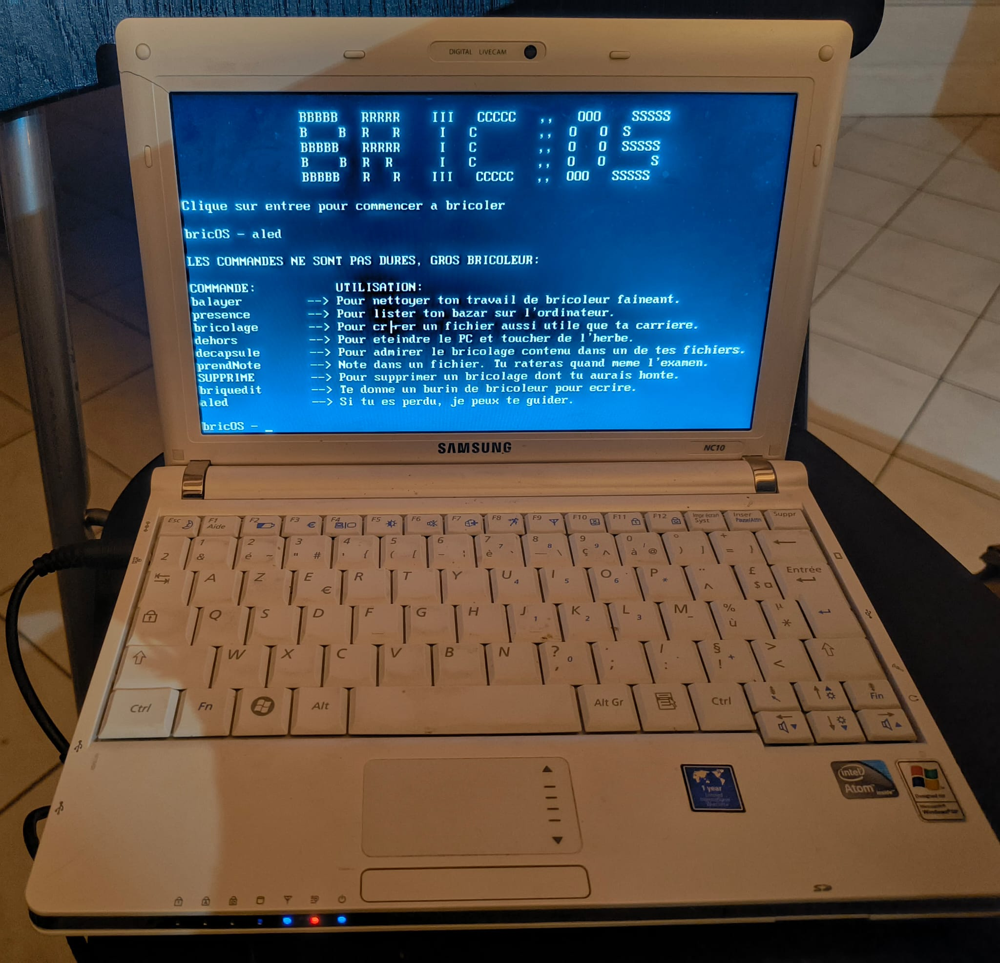

# Bric'OS 32bits

**This OS is currently a POC. The functionnalities are not really developped, and the code is probably shit.**

## General informations

Bric'OS is a POC to understand bootloader, kernel, and os modes in general. This is not aiming to be a full OS anytime. However, it is funny to developp around, and the 32b version is aiming to have more functionnalities thant the 16 one.

## Usage

### Virtual Environement

Everything is launchable via the makefile. You just need to have qemu and nasm installed (brew or apt or pacman for your distro, if you dont know, watch 74.125.200.101). The makefile use commands under a macintosh environnement, so you will probably have to change the LD and CC variables in the makefile to adapt to your machine.

```make clean```

It is cleaning all the binaries files and the image file in the bin folder.

```make all```

This command generate all the binaries and the image file in the bin folder (you need to create that folder !!).

```make run```

This command starts the qemu virtual machine to execute the Bootloader.

### Real Hardware

If you want to run bricOS on real hardware, you can flash the bricOS-32b.img on the disk with another operating system. On the restart, bricOS should work perfectly (except for the power off function, I need to work on that).

```sudo dd if=bricOS-32b.img of=/dev/sdX bs=1M conv=fsync```


You can also use this image on a USB drive, but the file commands will not work, since the os is going to look for a fat32 disk. If the disk is not on this format, the system will crash. Consider using ventoy to start the image in memdisk mode (with ctrl + D), because the normal mode may not work.

## How, why, and is it free for profit

Assembly and C. Why ? because it is funny.

### Bric'OS
Because of our teacher, that always said we were "bricoleurs", I thought we needed an OS like that.

### Future
This project aims only to make me learn new stuff about boot, etc. So it will be maintained and upgraded as long as I need to learn. Version 64 should come in UEFI after I cover the 32bits elemantary stuff.

### Free ?
Do whatever the F you want with this project, I don't care

